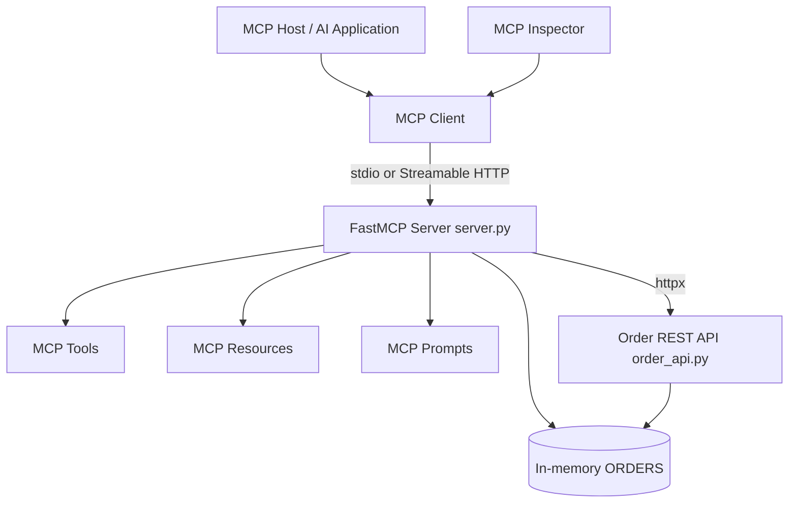

# Lab 04: Build a Custom MCP Server with Python for Order Management

## 1. Lab Name

**Custom MCP Server with Python — Order Management Tools and REST Integration**

## 2. Description

In this lab, participants build a **Model Context Protocol (MCP)** server in Python using **FastMCP**, expose business capabilities as **tools**, **resources**, and **prompts**, test with **MCP Inspector**, implement a **Python MCP client**, and integrate a **REST API** backend. The lab closes with **Streamable HTTP** transport and connecting an **MCP-compatible AI host**.

Duration: **3–4 hours** (instructor-led)  
Audience: Python developers, AI engineers, solution architects, agentic AI developers

## 3. Use Case

### Business Scenario

An operations team manages customer orders. AI applications and copilots need a **standardized** way to:

- Look up order details and filter by status or value  
- Read order policy context  
- Reuse analysis prompt templates  
- Call existing **Order REST APIs** without rewriting business logic  

### Objective

Use MCP as the integration layer between AI hosts (clients) and Python business functions (server), progressing from local **stdio** to **HTTP** and an optional **LLM host**.

## 4. Learning Objectives

By the end of this lab, participants will be able to:

1. Explain how an MCP **host**, **client**, and **server** interact.  
2. Build a custom MCP server with **FastMCP** and Python type hints.  
3. Expose Python functions as MCP **tools**.  
4. Implement MCP **resources** and reusable **prompts**.  
5. Test capabilities using **MCP Inspector**.  
6. Develop a Python MCP **client** that lists and invokes tools programmatically.  
7. Integrate the MCP server with a **FastAPI** REST API.  
8. Run the same server over **stdio** and **Streamable HTTP**.  
9. Connect an MCP-compatible **AI application** to natural-language tool use.  

## 5. Solution Architecture

Early exercises use in-memory order data. Later exercises add a REST API, a Python client, and optional AI host integration.



### Component Responsibilities

| Component | Responsibility |
| --- | --- |
| `server.py` | Registers tools, resources, prompts; runs MCP transport |
| `client.py` | Launches server subprocess; discovers and invokes MCP capabilities |
| `order_api.py` | Sample enterprise REST API backed by the same order data |
| `api_server.py` | Starts MCP over Streamable HTTP (reuses `server.py`) |
| MCP Inspector | Interactive client for discovery and manual testing |

## 6. Technology Stack

| Area | Technology |
| --- | --- |
| Language | Python 3.11 or 3.12 |
| MCP SDK | Official Python SDK (`mcp[cli]`, FastMCP) |
| REST sample | FastAPI + Uvicorn |
| HTTP client | httpx |
| Config | python-dotenv |
| Testing UI | MCP Inspector (Node.js/npx) |
| Editor | VS Code + Python extension |

## 7. Prerequisites

Install and verify before starting:

| Software | Purpose |
| --- | --- |
| Python 3.11 or 3.12 | MCP server and client |
| VS Code | Editor |
| Python extension for VS Code | Debugging and execution |
| Git | Source control |
| Node.js LTS | MCP Inspector |
| Postman or browser (optional) | REST API testing |

Verify Python:

```bash
python --version
```

Expected (example):

```text
Python 3.12.x
```

Verify Node.js:

```bash
node --version
npm --version
```

## 8. Lab Setup

### Step 1: Create project folder

```bash
mkdir python-mcp-lab
cd python-mcp-lab
code .
```

### Step 2: Create and activate virtual environment

```bash
python -m venv .venv
```

Windows (PowerShell):

```powershell
.\.venv\Scripts\Activate.ps1
```

If PowerShell blocks activation, use Command Prompt:

```bat
.venv\Scripts\activate.bat
```

Mac/Linux:

```bash
source .venv/bin/activate
```

Alternatively, prefix commands with `.venv\Scripts\python.exe` (Windows) without activating.

### Step 3: Create dependencies file

Create `requirements.txt`:

```text
mcp[cli]
fastapi
uvicorn
httpx
python-dotenv
```

Install packages:

```bash
python -m pip install --upgrade pip
pip install -r requirements.txt
```

Verify MCP SDK:

```bash
python -c "from mcp.server.fastmcp import FastMCP; print('MCP SDK installed')"
```

Expected:

```text
MCP SDK installed
```

### Step 4: Configure environment variables

Create `.env` (used in the REST-backed tool section):

```env
ORDER_API_URL=http://127.0.0.1:8000
```

### Step 5: Protect secrets and local artifacts

Create `.gitignore`:

```text
.venv/
__pycache__/
*.pyc
.env
```

**Checkpoint — setup:** Virtual environment active, packages installed, project folder open in VS Code.

## 9. Project Structure

Create folders and placeholder files as you progress. Final layout:

```text
python-mcp-lab/
├── .venv/
├── data/
│   ├── __init__.py
│   └── orders.py
├── server.py
├── client.py
├── order_api.py
├── api_server.py
├── requirements.txt
├── .env
└── .gitignore
```

## 10. Create Sample Order Data

### Step 1: Create `data/orders.py`

```python
ORDERS = {
    101: {
        "order_id": 101,
        "customer": "Alice",
        "amount": 2500,
        "status": "Shipped",
        "priority": "Normal",
    },
    102: {
        "order_id": 102,
        "customer": "Bob",
        "amount": 75000,
        "status": "Pending",
        "priority": "High",
    },
    103: {
        "order_id": 103,
        "customer": "Charlie",
        "amount": 120000,
        "status": "Pending",
        "priority": "High",
    },
    104: {
        "order_id": 104,
        "customer": "David",
        "amount": 10000,
        "status": "Delivered",
        "priority": "Normal",
    },
}
```

### Step 2: Create `data/__init__.py`

Create an empty file `data/__init__.py` so `data.orders` imports correctly.

## 11. Implement Your First MCP Server (Starter Tools)

### Step 1: Understand FastMCP

FastMCP is a high-level interface in the MCP Python SDK. You register Python functions with decorators instead of implementing JSON-RPC manually.

### Step 2: Create initial `server.py`

Create `server.py` with two starter tools:

```python
from mcp.server.fastmcp import FastMCP

mcp = FastMCP("Order Management MCP")


@mcp.tool()
def greet_user(name: str) -> str:
    """Greet a user by name."""
    return f"Hello {name}, welcome to MCP!"


@mcp.tool()
def add_numbers(a: int, b: int) -> int:
    """Add two integer numbers."""
    return a + b


if __name__ == "__main__":
    mcp.run(transport="stdio")
```

### Step 3: Understand the code

| Element | Purpose |
| --- | --- |
| `FastMCP("Order Management MCP")` | Creates the named MCP server instance |
| `@mcp.tool()` | Exposes the function as an MCP tool |
| Type hints (`str`, `int`) | Used to build tool input JSON Schema |
| Docstrings | Describe when the tool should be used |
| `mcp.run(transport="stdio")` | Runs the server over standard input/output |

### Step 4: Run the server (stdio)

```bash
python server.py
```

The terminal may appear idle with no output. That is expected: the server waits for MCP protocol messages on stdin.

Press `Ctrl+C` to stop.

**Important:** Do not use ordinary `print()` to stdout in a stdio MCP server; it can corrupt the protocol stream. Log to **stderr** if needed.

## 12. Test the Server with MCP Inspector

MCP Inspector is a developer client for discovering and invoking server capabilities.

### Step 1: Start Inspector with your server

From the project directory (virtual environment active):

```bash
mcp dev server.py
```

Alternative:

```bash
npx @modelcontextprotocol/inspector python server.py
```

If `mcp` is not found, confirm the virtual environment is active and `pip install "mcp[cli]"` succeeded.

### Step 2: Connect

Inspector opens a local web UI or prints a URL. Choose **STDIO** transport if prompted and connect.

### Step 3: Discover tools

Open the **Tools** section. You should see:

- `greet_user`
- `add_numbers`

### Step 4: Execute `greet_user`

Arguments:

```json
{
  "name": "Alex"
}
```

Expected result:

```text
Hello Alex, welcome to MCP!
```

### Step 5: Execute `add_numbers`

```json
{
  "a": 10,
  "b": 20
}
```

Expected result:

```text
30
```

### Step 6: Try invalid input

```json
{
  "a": "hello",
  "b": 20
}
```

The SDK should reject invalid types instead of running the function.

### What to observe

Inspector acts as an MCP **client**. No LLM is involved yet.

**Checkpoint — Inspector:** Both starter tools appear and execute successfully.

## 13. Implement Order Management MCP Tools

Replace starter tools with order-management functions.

### Step 1: Update `server.py`

Replace the contents of `server.py` with:

```python
from mcp.server.fastmcp import FastMCP

from data.orders import ORDERS

mcp = FastMCP("Order Management MCP")


@mcp.tool()
def get_order(order_id: int) -> dict:
    """Get details of an order by order ID."""
    return ORDERS.get(order_id, {"error": "Order not found"})


@mcp.tool()
def list_orders() -> list[dict]:
    """List all available orders."""
    return list(ORDERS.values())


@mcp.tool()
def get_orders_by_status(status: str) -> list[dict]:
    """Find orders matching a status."""
    return [
        order
        for order in ORDERS.values()
        if order["status"].lower() == status.lower()
    ]


@mcp.tool()
def get_high_value_orders(minimum_amount: float = 50000) -> list[dict]:
    """Find orders with amount above the threshold."""
    return [
        order
        for order in ORDERS.values()
        if order["amount"] >= minimum_amount
    ]


if __name__ == "__main__":
    mcp.run(transport="stdio")
```

### Step 2: Restart Inspector and test tools

Restart `mcp dev server.py` (or reconnect Inspector) and run:

| Tool | Arguments | Expected result |
| --- | --- | --- |
| `get_order` | `{"order_id": 101}` | Alice's order (id 101) |
| `get_order` | `{"order_id": 999}` | `{"error": "Order not found"}` |
| `list_orders` | `{}` | Four orders |
| `get_orders_by_status` | `{"status": "Pending"}` | Orders 102 and 103 |
| `get_high_value_orders` | `{"minimum_amount": 50000}` | Orders 102 and 103 |

### Step 3: Understand execution flow

When you invoke `get_orders_by_status` with `"Pending"`, Inspector sends an MCP tool call; the server filters `ORDERS` and returns matching records.

## 14. Implement MCP Resources

**Tools** invoke operations. **Resources** expose addressable content for context.

### Step 1: Add a static resource

Add **before** the `if __name__ == "__main__"` block in `server.py`:

```python
@mcp.resource("orders://policy")
def get_order_policy() -> str:
    """Read the company's order policy."""
    return """
ORDER MANAGEMENT POLICY

1. Orders above 50000 require review.
2. Pending orders should be monitored.
3. Delivered orders cannot be cancelled.
4. Only authorized users may modify orders.
"""
```

### Step 2: Add a dynamic resource

```python
@mcp.resource("orders://{order_id}")
def get_order_resource(order_id: int) -> str:
    """Read an order as an MCP resource."""
    order = ORDERS.get(order_id)
    if order is None:
        return "Order not found"
    return str(order)
```

Example URI: `orders://101`

### Step 3: Test in Inspector

1. Open **Resources**.  
2. Read `orders://policy` — expect the policy text.  
3. For dynamic content, use template `orders://101` (Inspector may list templates separately).

**Discussion:** Tools are callable functions; resources are readable URIs. Tools can be read-only too—the difference is the MCP interface.

## 15. Implement MCP Prompts

### Step 1: Register `analyze_order` prompt

Add before the startup block in `server.py`:

```python
@mcp.prompt()
def analyze_order(order_id: int) -> str:
    """Create an order analysis prompt."""
    return f"""
You are an enterprise order analyst.

Analyze order ID {order_id}.

Tasks:
1. Retrieve order details.
2. Review the order management policy.
3. Identify possible risks.
4. Recommend next actions.

Do not invent missing information.
"""
```

### Step 2: Test in Inspector

1. Open **Prompts**.  
2. Select `analyze_order` with `{"order_id": 102}`.  
3. Confirm generated text references order 102 and the four tasks.

**Important:** Fetching a prompt does **not** run tools or call an LLM. The host must pass the prompt to a model and orchestrate tool calls.

**Checkpoint — server surface:** Tools, resources, and prompts are all registered.

## 16. Implement a Python MCP Client

Previously, Inspector was the client. This section shows programmatic host integration.

### Step 1: Client architecture

1. Client spawns the server as a subprocess (`python server.py`).  
2. `stdio_client` opens read/write streams.  
3. `ClientSession.initialize()` negotiates the MCP session.  
4. Client calls `list_tools`, `call_tool`, `read_resource`, and `get_prompt`.

### Step 2: Create `client.py`

```python
import asyncio
import sys
from pathlib import Path

from mcp import ClientSession, StdioServerParameters
from mcp.client.stdio import stdio_client


def tool_result_text(result) -> str:
    """Extract text from a CallToolResult (SDK versions may vary slightly)."""
    chunks = []
    for block in result.content:
        if getattr(block, "type", None) == "text":
            chunks.append(block.text)
    return "\n".join(chunks) if chunks else str(result.content)


async def main() -> None:
    server_path = str(Path(__file__).resolve().parent / "server.py")
    server_params = StdioServerParameters(
        command=sys.executable,
        args=[server_path],
    )

    async with stdio_client(server_params) as (read_stream, write_stream):
        async with ClientSession(read_stream, write_stream) as session:
            await session.initialize()
            print("\nConnected to MCP Server")

            tools = await session.list_tools()
            print("\nAvailable Tools:")
            for tool in tools.tools:
                print(f"- {tool.name}")

            order_result = await session.call_tool(
                "get_order",
                arguments={"order_id": 102},
            )
            print("\nOrder Details:")
            print(tool_result_text(order_result))

            policy = await session.read_resource("orders://policy")
            print("\nOrder Policy:")
            print(policy.contents[0].text)

            prompt = await session.get_prompt(
                "analyze_order",
                arguments={"order_id": 102},
            )
            print("\nAnalysis Prompt:")
            for message in prompt.messages:
                content = message.content
                if hasattr(content, "text"):
                    print(content.text)
                else:
                    print(content)


if __name__ == "__main__":
    asyncio.run(main())
```

### Step 3: Run the client

Open a **new** terminal in the project directory with the virtual environment active:

```bash
python client.py
```

### Step 4: Expected output (illustrative)

Exact formatting may vary by SDK version:

```text
Connected to MCP Server

Available Tools:
- get_order
- list_orders
- get_orders_by_status
- get_high_value_orders

Order Details:
{ ... order 102 ... }

Order Policy:
ORDER MANAGEMENT POLICY
1. Orders above 50000 require review.
...

Analysis Prompt:
You are an enterprise order analyst.
Analyze order ID 102.
...
```

### Step 5: Experiment

Change `order_id` to `103` and re-run. Then replace the `call_tool` block with:

```python
pending = await session.call_tool(
    "get_orders_by_status",
    arguments={"status": "Pending"},
)
print("\nPending Orders:")
print(tool_result_text(pending))
```

**Checkpoint — client:** Session initializes, tools are listed, tool/resource/prompt calls succeed.

## 17. Integrate the MCP Server with a REST API

Enterprise MCP servers often front existing HTTP APIs.

### Step 1: Create `order_api.py`

```python
from fastapi import FastAPI, HTTPException

from data.orders import ORDERS

app = FastAPI(title="Order Management API")


@app.get("/health")
def health():
    return {"status": "healthy"}


@app.get("/orders")
def list_orders():
    return list(ORDERS.values())


@app.get("/orders/{order_id}")
def get_order(order_id: int):
    order = ORDERS.get(order_id)
    if not order:
        raise HTTPException(status_code=404, detail="Order not found")
    return order
```

### Step 2: Start the REST API

**Terminal 1:**

```bash
uvicorn order_api:app --reload --port 8000
```

Open interactive docs: [http://127.0.0.1:8000/docs](http://127.0.0.1:8000/docs)

Test:

```http
GET http://127.0.0.1:8000/orders/102
```

Expected JSON body includes `"customer": "Bob"`, `"status": "Pending"`.

### Step 3: Add REST-backed MCP tool

Add imports at the top of `server.py`:

```python
import os

import httpx
from dotenv import load_dotenv

load_dotenv()
```

Add this tool before the startup block:

```python
@mcp.tool()
async def get_order_from_api(order_id: int) -> dict:
    """Retrieve an order from the Order REST API."""
    base_url = os.getenv("ORDER_API_URL", "http://127.0.0.1:8000")
    async with httpx.AsyncClient(timeout=10.0) as client:
        try:
            response = await client.get(f"{base_url}/orders/{order_id}")
            response.raise_for_status()
            return response.json()
        except httpx.HTTPStatusError as exc:
            return {
                "error": "Order API returned an error",
                "status_code": exc.response.status_code,
            }
        except httpx.RequestError:
            return {"error": "Order API is unavailable"}
```

### Step 4: Test `get_order_from_api`

Keep the REST API running. Restart Inspector and invoke:

```json
{
  "order_id": 102
}
```

Tool: `get_order_from_api`

### Step 5: Test failure handling

Stop Uvicorn and invoke `get_order_from_api` again.

Expected:

```json
{
  "error": "Order API is unavailable"
}
```

## 18. Expose the MCP Server over Streamable HTTP

Local development often uses **stdio**. Remote integrations use **Streamable HTTP**.

### Step 1: Create `api_server.py`

```python
from server import mcp

if __name__ == "__main__":
    mcp.settings.port = 8001
    mcp.run(transport="streamable-http")
```

Port **8001** avoids conflict with the REST API on **8000**.

### Step 2: Start the HTTP MCP server

**Terminal 2** (REST API may stay on 8000):

```bash
python api_server.py
```

Default MCP endpoint (verify in console output if your SDK differs):

```text
http://127.0.0.1:8001/mcp
```

### Step 3: Test with Inspector

**Terminal 3:**

```bash
npx @modelcontextprotocol/inspector
```

Choose **Streamable HTTP** and connect to `http://127.0.0.1:8001/mcp`. Discover and invoke the same tools as before.

**Observation:** Transport changed; business logic in `server.py` did not.

For production: add authentication, authorization, TLS, and network controls.

## 19. Connect MCP to an AI Application

### Step 1: Configure an MCP-compatible host

Example configuration pattern (paths must match your machine):

```json
{
  "mcpServers": {
    "order-management": {
      "command": "C:/projects/python-mcp-lab/.venv/Scripts/python.exe",
      "args": ["C:/projects/python-mcp-lab/server.py"]
    }
  }
}
```

Restart or reconnect the host so it discovers the server. Configuration format varies by product (VS Code Copilot MCP, Claude Desktop, etc.).

### Step 2: Natural-language test prompts

Try in the connected AI application:

1. Show me the details of order 102.  
2. List all pending orders.  
3. Find all orders above 50000.  
4. Review order 103 against the order management policy.  
5. Which high-value orders are still pending?  

### Step 3: Observe the AI workflow

For “List all pending orders”:

1. Host exposes tool definitions to the LLM.  
2. LLM selects `get_orders_by_status`.  
3. Host invokes the tool via MCP.  
4. Server returns orders 102 and 103.  
5. Host passes results back to the LLM.  
6. LLM produces the user-facing answer.  

An MCP client alone does not perform reasoning—the **host** must integrate the LLM and tool loop.

## 20. Participant Extension Exercises

Complete independently (approximately 30 minutes):

| # | Exercise | Goal |
| --- | --- | --- |
| 1 | `get_order_summary()` tool | Return counts and total value (all, pending, delivered) |
| 2 | `get_high_risk_orders()` tool | Pending orders with amount > 50,000 |
| 3 | `orders://summary` resource | Expose summary as readable resource |
| 4 | `analyze_pending_orders()` prompt | Template for LLM pending-order analysis |
| 5 | REST error handling | Handle unknown order ID and API unavailable paths explicitly |

## 21. How to Run the Full Lab (Multi-Terminal Reference)

| Terminal | Command | Purpose |
| --- | --- | --- |
| 1 | `uvicorn order_api:app --reload --port 8000` | REST API (sections 17+) |
| 2 | `python api_server.py` | MCP over HTTP (section 18) |
| 3 | `mcp dev server.py` **or** `python client.py` | Inspector or Python client |
| 4 | AI host with stdio config | Section 19 |

For stdio-only paths (sections 11–16), a single terminal plus Inspector is enough.

## 22. Trainer Demo Script (45–60 Minutes)

1. Show project structure and `data/orders.py`.  
2. Run Inspector against starter tools, then order tools.  
3. Demonstrate one resource and one prompt in Inspector.  
4. Run `python client.py` and narrate the MCP session lifecycle.  
5. Start REST API; call `get_order_from_api` from Inspector.  
6. Stop API to show graceful error payload.  
7. Optional: Streamable HTTP on port 8001.  
8. Optional: one natural-language question in an MCP-enabled AI host.  

## 23. Troubleshooting

| Problem | Possible cause | Solution |
| --- | --- | --- |
| `ModuleNotFoundError: mcp` | Wrong interpreter | Activate `.venv`; reinstall requirements |
| `mcp` command not found | CLI not installed | `pip install "mcp[cli]"` |
| Inspector cannot connect | Wrong path or Python | Use full path to venv Python and `server.py` |
| Tool does not appear | Stale server | Restart server and reconnect Inspector |
| `Connection refused` | REST API down | Start Uvicorn on port 8000 |
| `Address already in use` | Port conflict | REST on 8000, MCP HTTP on 8001 |
| MCP protocol parse error | stdout pollution | Remove `print()` from stdio server code |
| Tool returns error | Bad args or backend | Validate JSON args and API logs |
| `client.py` attribute errors | SDK version drift | Compare with installed `mcp` version docs |

## 24. Validation Checklist

Before marking the lab complete, verify:

- [ ] Virtual environment active and dependencies installed  
- [ ] `data/orders.py` and `data/__init__.py` exist  
- [ ] `python server.py` starts (stdio) without crashing  
- [ ] MCP Inspector lists order tools and executes test matrix (section 13)  
- [ ] Resources `orders://policy` and `orders://101` readable  
- [ ] Prompt `analyze_order` returns templated text  
- [ ] `python client.py` connects, lists tools, calls tool, reads resource and prompt  
- [ ] REST API responds on `/orders/102`  
- [ ] `get_order_from_api` succeeds with API up and returns error when API is down  
- [ ] Streamable HTTP server reachable at `http://127.0.0.1:8001/mcp` (if completed)  
- [ ] MCP-compatible AI host can invoke at least one tool from natural language (if completed)  

## 25. Conclusion

This lab demonstrates the enterprise integration pattern:

```text
AI Host = LLM + MCP Client + (Tools + Resources + Prompts) + Optional REST APIs
```

MCP standardizes how capabilities are **discovered** and **invoked**; your existing Python services and REST APIs remain the system of record.

### Recommended next lab

**Enterprise MCP Server** with authenticated remote access, database backing, Docker, tool-level permissions, approval workflows, structured logging, automated tests, and container deployment.

### Official references

- [MCP documentation](https://modelcontextprotocol.io/docs/getting-started/intro)  
- [Python MCP SDK](https://github.com/modelcontextprotocol/python-sdk)  
- [MCP Inspector](https://modelcontextprotocol.io/docs/tools/inspector)  
